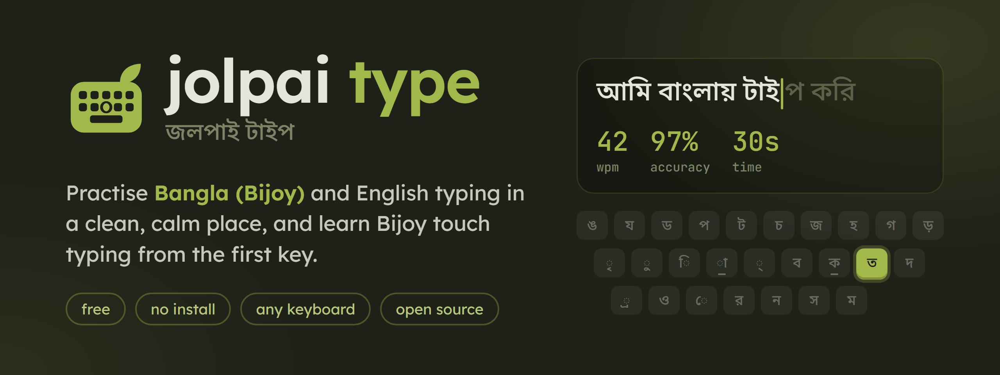
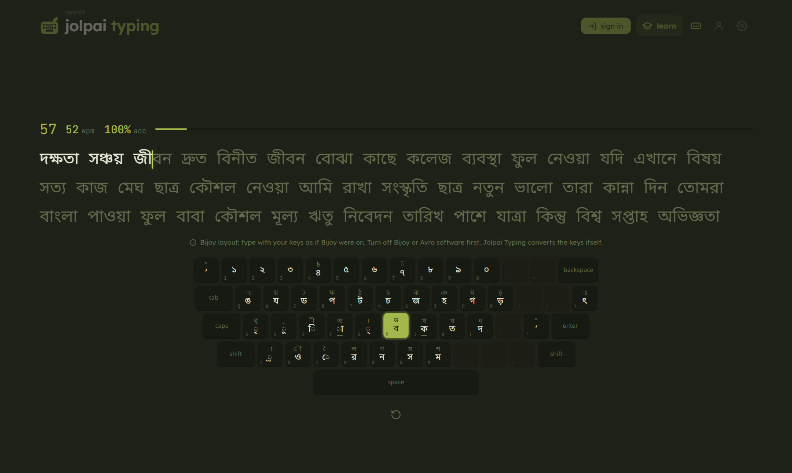
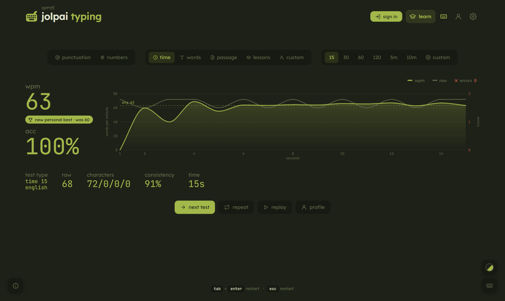
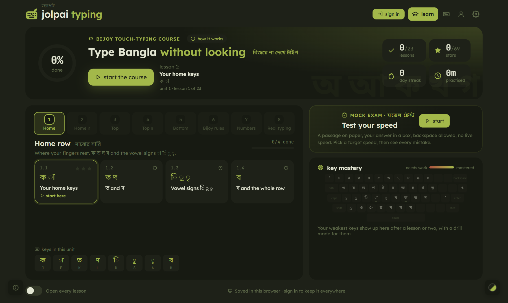
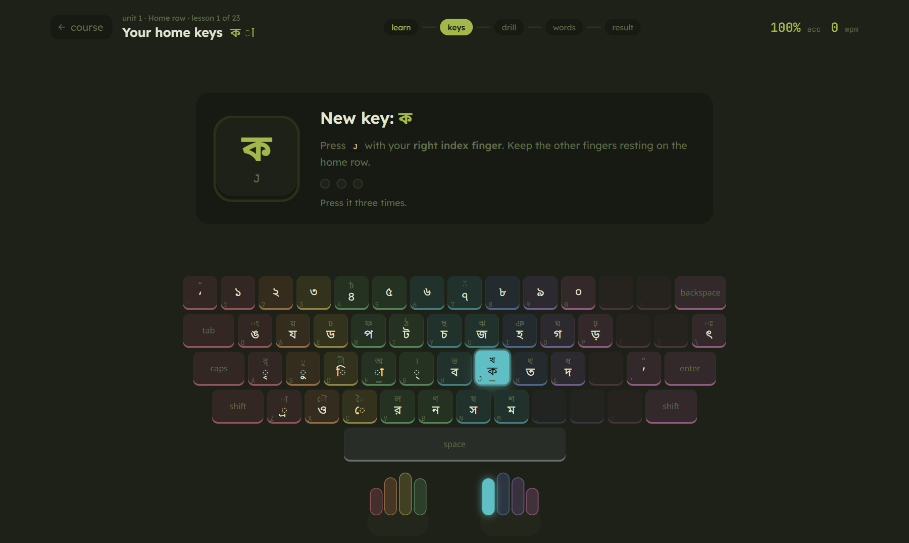
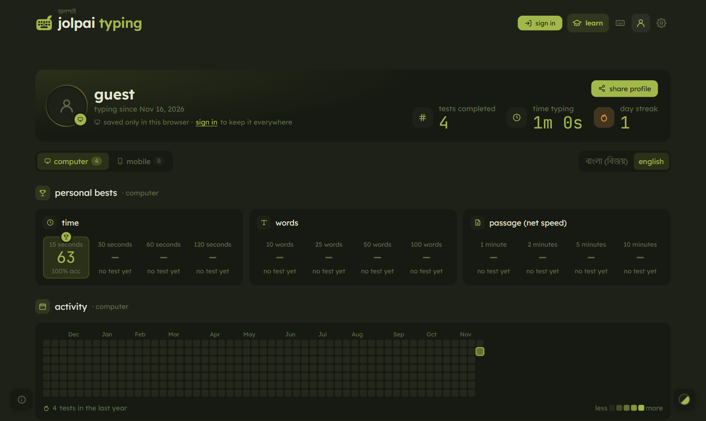
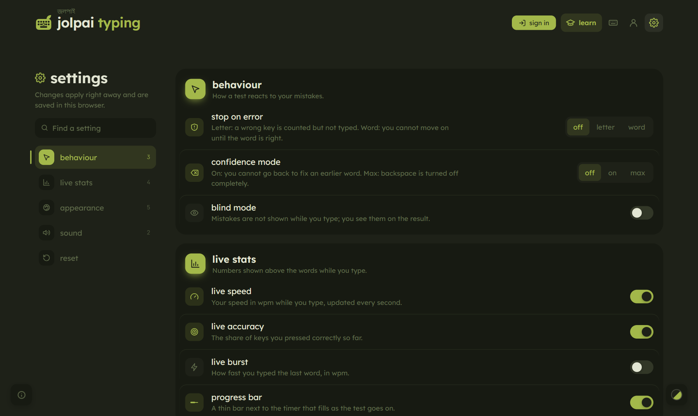

<div align="center">

<a href="https://yeamin-talukder.github.io/jolpai-typing/">
  
</a>

<h1>Jolpai Typing: Bangla (Bijoy) typing practice and tutor</h1>

<p><b>জলপাই টাইপিং</b>: অনলাইনে বিনামূল্যে বাংলা টাইপিং অনুশীলন ও বিজয় টাইপিং শেখার জায়গা</p>

<p><b>Made for Bangla typing</b> · বাংলা টাইপিংয়ের জন্য তৈরি · for everyone who wants to type Bangla fast and correctly</p>

[](https://github.com/Yeamin-Talukder/jolpai-typing/stargazers)
[](https://github.com/Yeamin-Talukder/jolpai-typing/network/members)
[](https://github.com/Yeamin-Talukder/jolpai-typing)
[](LICENSE)

[](https://yeamin-talukder.github.io/jolpai-typing/)
[](https://github.com/Yeamin-Talukder/jolpai-typing/actions/workflows/deploy.yml)
[](https://github.com/Yeamin-Talukder/jolpai-typing/commits/main)
[](https://github.com/Yeamin-Talukder/jolpai-typing/watchers)
[](https://github.com/Yeamin-Talukder/jolpai-typing/issues)

### [Open Jolpai Typing →](https://yeamin-talukder.github.io/jolpai-typing/)

[বাংলা টাইপিং টেস্ট (Bangla typing test)](https://yeamin-talukder.github.io/jolpai-typing/bangla-typing-test/) · [বিজয় টাইপিং শিখুন (Learn Bijoy typing)](https://yeamin-talukder.github.io/jolpai-typing/bijoy-typing-tutor/)

[Report a bug](https://github.com/Yeamin-Talukder/jolpai-typing/issues/new) · [Suggest a feature](https://github.com/Yeamin-Talukder/jolpai-typing/issues/new) · [Give it a star](https://github.com/Yeamin-Talukder/jolpai-typing/stargazers)

<sub>Formerly <b>Jolpai Type</b>. Old links still work.</sub>

<br />
<br />



</div>

---

## Contents

- [Why Jolpai Typing](#why-jolpai-typing)
- [Screenshots](#screenshots)
- [বাংলায় জলপাই টাইপিং](#বাংলায়-জলপাই-টাইপিং)
- [Features](#features)
- [How Bijoy typing works here](#how-bijoy-typing-works-here)
- [Run it locally](#run-it-locally)
- [Tech stack](#tech-stack) · [Project structure](#project-structure)
- [FAQ](#faq)
- [Contributing](#contributing) · [Support the project](#support-the-project) · [License](#license)

## Why Jolpai Typing

Jolpai Typing is a free online **Bangla typing test** and **Bijoy typing tutor** that runs in your browser. Practise Bangla (Bengali) typing on the Bijoy keyboard layout, take English typing tests, and learn Bijoy touch typing from the very first key.

There was no good place to practise **Bangla typing**. English has polished, modern typing sites, but people who type Bangla were left with old, cluttered pages that are hard to enjoy. Jolpai Typing gives Bangla typing a good environment: a clean, calm, distraction-free typing test with a careful design, and a course that teaches **Bijoy** touch typing step by step. English is here too.

| | |
| --- | --- |
| **No software to install** | Press the Bijoy keys on any keyboard and the site turns them into Bangla as you type. |
| **Learn from zero** | 23 lessons take you from the home row to যুক্তাক্ষর, ফলা and reph, with the finger for every key. |
| **See yourself improve** | Every test is saved with its speed graph, and your profile shows bests, a progress graph and an activity calendar. |
| **Free and open source** | No sign-up needed. Sign in with Google only if you want your progress on every device. |

## Screenshots

<table>
  <tr>
    <td width="50%"><br /><sub><b>Results</b>: speed, accuracy, consistency and a speed graph for every test</sub></td>
    <td width="50%"><br /><sub><b>Learn Bijoy</b>: 8 units, 23 lessons, a mock exam and key mastery</sub></td>
  </tr>
  <tr>
    <td width="50%"><br /><sub><b>Lessons</b>: the next key and the finger to press it with</sub></td>
    <td width="50%"><br /><sub><b>Profile</b>: personal bests, activity and full history</sub></td>
  </tr>
  <tr>
    <td colspan="2" align="center"><br /><sub><b>Settings</b>: behaviour, live stats, appearance and sound</sub></td>
  </tr>
</table>

## বাংলায় জলপাই টাইপিং

**জলপাই টাইপিং** একটি বিনামূল্যের অনলাইন **বাংলা টাইপিং** অনুশীলনের ওয়েবসাইট। এখানে **বিজয় কি-বোর্ড** লেআউটে বাংলা টাইপ করা যায় যেকোনো কি-বোর্ডে, কোনো বিজয় বা অভ্র সফটওয়্যার ইনস্টল করতে হয় না। সুন্দর, শান্ত ও ঝামেলামুক্ত পরিবেশে টাইপিং অনুশীলন করুন আর ধাপে ধাপে **বিজয় টাচ টাইপিং শিখুন**।

- **বাংলা টাইপিং টেস্ট:** সময়, শব্দ সংখ্যা, অনুচ্ছেদ বা নিজের লেখা দিয়ে অনুশীলন। ইংরেজি টাইপিং টেস্টও আছে।
- **বিজয় টাইপিং কোর্স:** ৮টি ইউনিটে ২৩টি পাঠ, হোম রো থেকে যুক্তাক্ষর, ফলা ও রেফ পর্যন্ত। প্রতিটি কি কোন আঙুলে চাপতে হবে তা কি-বোর্ড ও হাতের ছবিতে দেখানো হয়।
- **মডেল টেস্ট:** কাগজের মতো অনুচ্ছেদ দেখে টাইপ করুন, লক্ষ্য গতি বেছে নিন, তারপর প্রতিটি ভুল শব্দ ধরে দেখুন।
- **অগ্রগতি:** গতি (WPM), নির্ভুলতা, সেরা ফলাফল, অগ্রগতির গ্রাফ ও প্রতিদিনের অনুশীলনের হিসাব।
- **বিনামূল্যে ও ওপেন সোর্স:** সাইন আপ লাগে না। চাইলে Google দিয়ে সাইন ইন করে সব ডিভাইসে অগ্রগতি রাখুন।

👉 **[এখনই অনুশীলন শুরু করুন](https://yeamin-talukder.github.io/jolpai-typing/)**

## Features

### Typing tests
- **Bangla (Bijoy) and English**, switched with one click.
- **Modes:** time (15 s to 10 min), word count (10 to 100), real passages (1 to 10 min), and your own **custom** time, word count or text.
- **Punctuation and numbers** can be added to random-word tests.
- **Live stats** while you type: speed, accuracy, burst and a progress bar (each one optional).
- An optional **on-screen keyboard** that lights up the next key.

### Learn Bijoy
- A **23-lesson touch-typing course in 8 units**, from the home row to the Bijoy rules: vowel signs typed first, যুক্তাক্ষর, ফলা and reph.
- Each lesson explains, then demonstrates with keys that type themselves, then drills: an **on-screen keyboard and hands show which finger to use** for every key.
- **Stars** for each lesson, a **key mastery heat map**, and drills made from your **weakest keys**.
- A **mock exam**: a passage on paper and your answer in a box, with a target speed of your choice and a word-by-word review.

### Results and progress
- Speed, raw and net speed, accuracy, consistency and character counts, with a **speed graph** for every test.
- A **key-by-key replay** of the test on the keyboard, with a full-screen view.
- A **profile** with personal bests, a progress graph, an activity calendar and your full history. Phone and computer results are kept apart.
- **Share your profile** with a link or a QR code.

### Make it yours
- **6 colour themes**: jolpai, jolpai light, shapla, nodi, mati and doel.
- Text size, caret style, smooth caret, key sounds, an error sound, stop on error, confidence mode and blind mode.
- Works on phones and tablets as well as computers.

### Keyboard shortcuts

| Keys | Action |
| --- | --- |
| <kbd>Tab</kbd> + <kbd>Enter</kbd> | restart the test |
| <kbd>Esc</kbd> | restart the test, or go back from a page |

## How Bijoy typing works here

Jolpai Typing has its own Bijoy engine ([`src/bijoy.ts`](src/bijoy.ts)). It reads which physical key you pressed, so it works the same on any keyboard and in any browser, with no Bijoy software installed. Like Bijoy itself, you type in **visual order**: a vowel sign that sits before a consonant (ি, ে, ৈ) is typed before it, and <kbd>g</kbd> joins letters into যুক্তাক্ষর. The key map follows the standard Bijoy layout and is covered by tests.

## Run it locally

You need [Node.js](https://nodejs.org/) 22 or newer.

```bash
git clone https://github.com/Yeamin-Talukder/jolpai-typing.git
cd jolpai-typing
npm install
npm run dev
```

Then open the address Vite prints (usually `http://localhost:5173/`).

| Command | What it does |
| --- | --- |
| `npm run dev` | start the dev server |
| `npm test` | run the unit tests |
| `npm run build` | type-check and build the site into `dist/` |
| `npm run preview` | serve the built site |
| `npm run test:rules` | test the Firestore rules on the emulator (needs the Firebase CLI and Java) |
| `npm run dev:emulators` | run the site against local Auth and Firestore emulators |

## Tech stack


| Part | Used |
| --- | --- |
| App | TypeScript and plain DOM, no framework, built with [Vite](https://vitejs.dev/) |
| Accounts and sync | [Firebase](https://firebase.google.com/) Authentication (Google sign-in) and Cloud Firestore |
| Tests | [Vitest](https://vitest.dev/) for the app, and the Firebase emulator for the Firestore security rules |
| Hosting | GitHub Pages, deployed by [GitHub Actions](.github/workflows/deploy.yml) on every push to `main` |

## Project structure

```text
src/
  main.ts            the typing test, views and wiring
  bijoy.ts           the Bijoy to Unicode engine
  keyboard.ts        the on-screen keyboard
  words.ts           English words      words-bn.ts   Bangla words
  passages.ts        practice passages in both languages
  profile.ts         profile page        progress-chart.ts, chart.ts   graphs
  replay.ts          key-by-key replay   settings-page.ts, prefs.ts   settings
  account.ts         Google sign-in, sync and profile sharing
  learn/             the Bijoy course: lessons, finger guide, player, mock exam, progress
firestore.rules      who can read and write what
rules-tests/         tests for those rules
scripts/             sources of the README banner and the social preview image
```

## FAQ

### How can I practise Bangla typing online for free?
Open [Jolpai Typing](https://yeamin-talukder.github.io/jolpai-typing/), choose বাংলা (বিজয়), and start typing. It is free, with no sign-up and nothing to install.

### Do I need Bijoy or Avro software installed?
No. The site turns your Bijoy key presses into Bangla by itself, on any keyboard and in any modern browser.

### Can I learn Bijoy typing from zero?
Yes. The Learn section starts at the home row and teaches every key with the finger to use, then joined letters (যুক্তাক্ষর), ফলা and reph, up to full speed.

### Does it work for English typing too?
Yes. Switch to english for the same tests, results and progress tracking.

### Is my progress saved?
Yes, in your browser, straight away. Sign in with Google to keep it on every device.

### বিজয়ে বাংলা টাইপিং কীভাবে শিখব?
[জলপাই টাইপিং](https://yeamin-talukder.github.io/jolpai-typing/) খুলে "learn" এ যান। হোম রো থেকে শুরু করে ধাপে ধাপে প্রতিটি কি শেখানো হয়, কোন আঙুল দিয়ে চাপতে হবে তা সহ।

### বাংলা টাইপিং অনুশীলনের জন্য কি টাকা লাগে?
না, জলপাই টাইপিং সম্পূর্ণ বিনামূল্যে, কোনো সফটওয়্যার ইনস্টল করতে হয় না।

## Contributing

Ideas, bug reports and pull requests are welcome.

1. [Open an issue](https://github.com/Yeamin-Talukder/jolpai-typing/issues/new) to report a bug or suggest something.
2. For code changes, fork the repo, make a branch, and check that `npm test` and `npm run build` pass before opening a pull request.

## Support the project

If Jolpai Typing helps you type Bangla, please **[give it a star](https://github.com/Yeamin-Talukder/jolpai-typing)**. It helps other Bangla typists find it.

<div align="center">

<a href="https://star-history.com/#Yeamin-Talukder/jolpai-typing&Date">
  
</a>

</div>

## License

Jolpai Typing is free and open source under the [MIT License](LICENSE). You can use, change and share the code, as long as the copyright notice stays with it.

## Author

Made by **[Md Yeamin Talukder](https://github.com/Yeamin-Talukder)**, also the maker of [Jolpai Keyboard](https://github.com/Yeamin-Talukder/jolpai-keyboard), a typing keyboard for phones.

---

<div align="center">

**Made with ❤️ for Bangla typing.** Free Bangla typing practice, Bijoy typing test and Bijoy typing tutor, online.

বাংলা টাইপিংয়ের জন্য ভালোবাসা দিয়ে তৈরি · বিনামূল্যে বাংলা টাইপিং অনুশীলন ও বিজয় টাইপিং শেখা

<a href="https://yeamin-talukder.github.io/jolpai-typing/"><b>yeamin-talukder.github.io/jolpai-typing</b></a>

</div>
